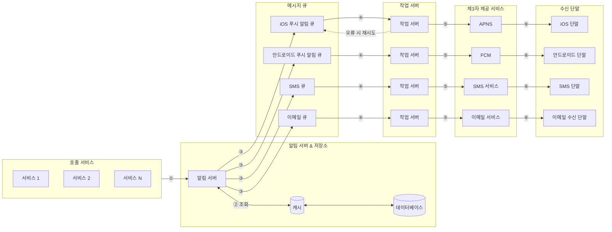
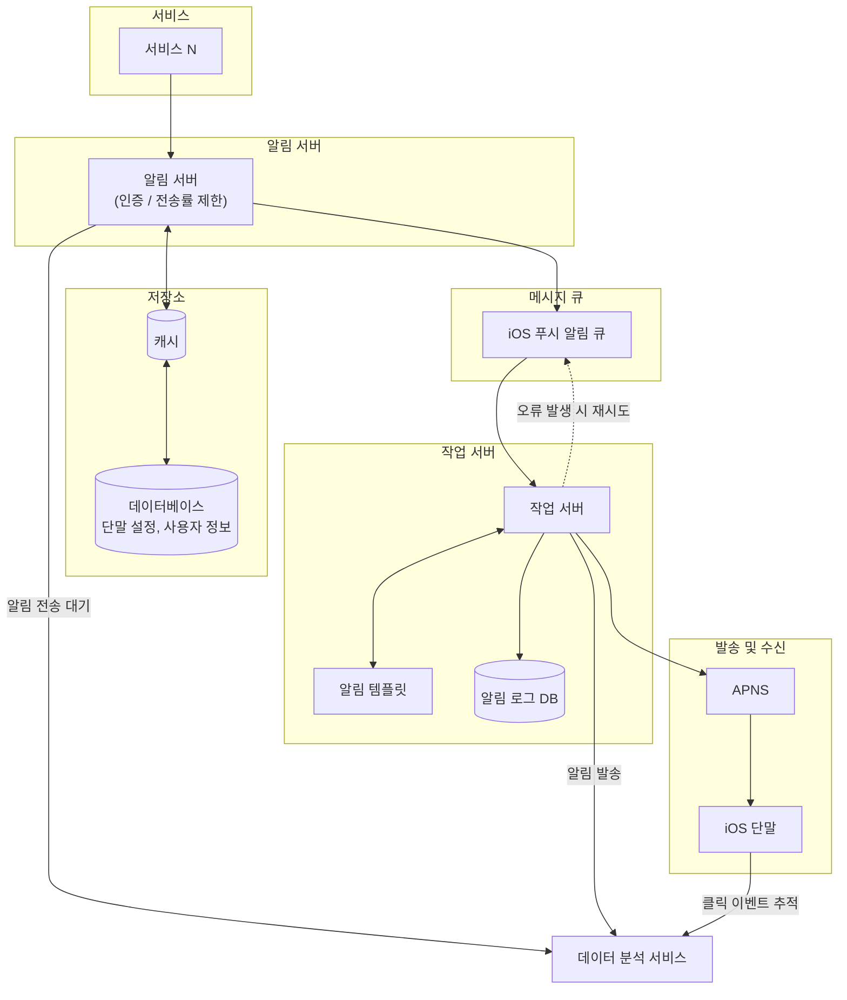
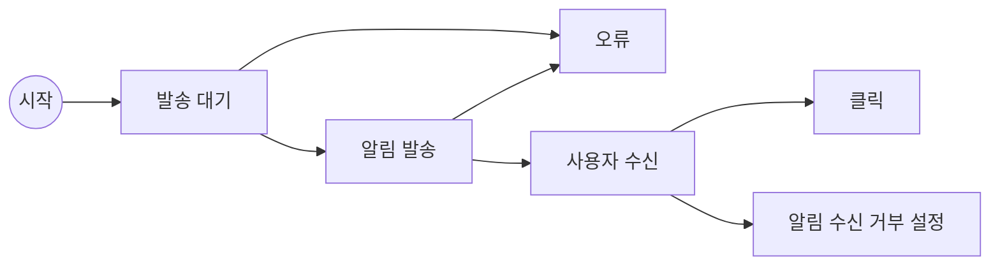

# 10장 : 알림 시스템 설계
> **스터디 정보**  
> - **주차**: 5주차
> - **작성자**: 강상준  
> - **주제**: 10장 - 알림 시스템 설계

---
알림 시스템은
- 모바일 푸시 알림
- SMS 메시지
- 이메일
세 가지로 분류할 수 있다.
-> 컴퓨터 프로그램에서 시스템 알림으로 띄우는 이런거는 안 들어가는 건가? 싶긴하네
    -> 어차피 윈도우 - 안드로이드 , 맥북 - iOS라 똑같음 시스템이

## 1단계 - 시스템 이해 및 설계 범위 확정

**고려해야할 부분**
- 어떤 종류의 알림을 지원하나?
- 실시간 시스템이어야 하는가?
- 어떤 종류의 단말을 지원?
- 알림을 보내는 주체는 누구인가? 누가 알림을 만드는가?
- 사용자가 알림 거부를 할 수 있는가?
- 하루에 몇 건의 알림을 보낼 수 있어야 하는가?

## 2단계 - 개략적 설계안 제시 및 동의 구하기
iOS / 안드로이드 푸시 알림, SMS 메시지, 이메일을 지원하는 시스템의 설계안을 살펴본다.

### 알림 유형별 지원 방안
#### iOS 푸시 알림
**알림제공자 -> APNS -> iOS 단말**
이렇게 세 가지의 컴포넌트가 필요하다

- 알림 제공자
    알림 요청을 만들려면 다음과 같은 데이터가 필요하다.
        1. 단말 토큰(device token): 알림 요청을 보내는 데 필요한 고유 식별자
        2. 페이로드: 알림 내용을 담은 JSON 딕셔너리
- APNS: 애플이 제공하는 원격 서비스. 푸시 알림을 iOS 장치로 보냄
#### 안드로이드 푸시 알림
**알림 제공자 -> FCM(Firebase Cloud Messaging) -> 안드로이드 단말**

#### SMS 메시지
**알림 제공자 -> SMS 서비스 -> SMS 수신 단말**
보통 제3사업자의 서비스를 많이 이용

#### 이메일
**알림 제공자 -> 이메일 서비스 -> 이메일 수신 단말**

### 연락처 정보 수집 절차
알림을 보내려면 device token, 전화번호, 이메일 주소 등의 정보를 수집해야한다.
사용자가 우리 앱을 설치하거나 처음으로 계정을 등록하면 해당 사용자의 정보를 수집하여 DB에 저장한다.

### 알림 전송 및 수신 절차

알림서버를 단일로 두면 SPOF문제, 성능 병목이 이루어질 수 있으므로 다중화한다.
또한 메시지 큐를 이용해 시스템 컴포넌트 사이의 강한 결합을 끊는다(비동기적 처리)
-> SMS 통신서 서버가 터져도 알림 서버는 지장이 없음(장애 격리가 가능함)
-> 알림 서버는 건드릴 필요 없이 보내야할 알림 양이 늘어나면 작업 서버만 늘려주면 됨
-> worker server분리에서 봤었음..

1. API를 호출하여 알림 서버로 알림을 보낸다.
2. 알림 서버는 메타데이터를 개시나 DB에서 가져온다. 
3. 알림 서버는 전송할 알림에 맞는 이벤트를 만들어서 해당 이벤트를 위한 메시지 큐에 전달.
4. 작업 서버는 메시지 큐에서 이벤트를 꺼내 3자 서비스로 전송한다
5. 3자 서비스는 단말로 알림을 전송한다.

## 3단계 - 상세 설계

### 안정성
분산 환경에서 운영될 알림 시스템 설계시 안정성 확보를 위해 다음 사항을 반드시 고려해야함

#### 데이터 손실 방지
가장 중요한 요구사항 중 하나가 알림이 어떤 상황에서도 소실되면 안 된다는 점이다.
지연이나 순서가 바뀌는 건 그래도 괜찮은데 소실되면 안 된다.

-> 작업 서버에 알림 로그 DB를 유지해 알림 데이터를 보관하고 재시도 메커니즘을 구현할 수 있다.
    -> 이거 오래된 알림 정리나, AI 비동기 처리 실패 상태 재시도 하려고 스케쥴러 돌렸었는데 비슷하게 생각하면 될듯

#### 알림 중복 전송 방지
완전히 막는 것은 가능하지 않음.
-> 네트워크 지연이 발생하지 않을 수 없기 때문에 ACK가 없으면 재전송해서? 그러지않을까
- [ ] 이거 책 [5] 참고문헌 확인하기 나중에
빈도를 줄이려면 중복을 탐지하는 매커니즘을 도입하고 오류를 신중하게 처리해야함
- 보내야 할 알림이 도착하면 그 이벤트 ID를 검사해 중복된 이벤트라면 버리고, 아니면 발송한다.
-> 근데 매 알림마다 검사한다면 비용이랑 trade-off 관계겠다.

### 추가로 필요한 컴포넌트 및 고려사항
#### 알림 템플릿

#### 알림 설정
알림이 전송될 채널, 수신여부를 알림 설정 테이블에 보관해 관리해야한다.

#### 전송률 제한
한 사용자가 받을 수 있는 알림의 빈도를 제한해서 너무 많은 알림을 보내지 않도록 한다.
-> 요새 나도 그렇고 무조건 알림 미동의하는데 확보하려면 이런거 잘 동의해야 할 것 같다.

#### 전송 재시도 방법

#### 푸시 알림과 보안
iOS나 안드로이드 앱의 경우, 알림 전송 API는 appKey와 appSecret을 사용해 보안을 유지함.
인증된, 승인된 클라이언트만 해당 API를 사용해 알림을 보낼 수 있다.

#### 큐 모니터링
알림 시스템 모니터링 할 때 중요한 메트릭 중 하나는
**큐에 쌓인 알림 개수**다. 너무 많으면 증설하는게 바람직하다.

#### 이벤트 추적
**알림 확인율, 클릭율, 실제 앱 사용으로 이어지는 비율과 같은 메트릭**은 되게 유용하다.
데이터 분석 서비스는 보통 이벤트 추적 기능도 제공한다. 따라서 알림 시스템을 만들면 데이터 분석 서비스와도 통합해야한다. 
<- 메트릭 써서 반응 보려면 해야겠다.. 이게 젤 중요할듯 피드백 보는게

**종전 설계안 대비 추가된 핵심 컴포넌트:**
- **인증(Authentication) 및 전송률 제한(Rate Limiting)**: 스팸 및 과도한 알림 방지
- **알림 템플릿**: 알림 생성 단순화 및 일관성 유지
- **알림 로그 DB**: 발송 이력 보관 및 실패 시 복구 지원
- **데이터 분석 서비스**: 전송 대기, 발송, 클릭 이벤트 추적으로 비즈니스 지표 측정

##### 알림 시스템 이벤트 추적 흐름 (그림 10-13)

---

### 수정된 설계안

