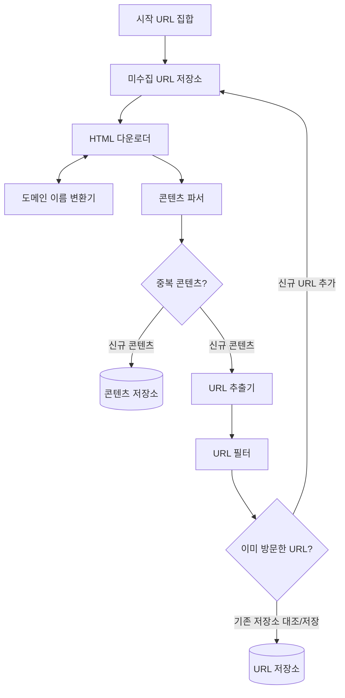

# 9장 : 웹 크롤러 설계
> **스터디 정보**  
> - **주차**: 5주차
> - **작성자**: 강상준  
> - **주제**: 9장 - 웹 크롤러 설계

---
웹 크롤러는 몇 개 웹 페이지에서 시작해 그 링크를 따라 나가면서 새로운 콘텐츠를 수집한다.
이 때 콘텐츠는 웹 페이지, 이미지나 비디오, PDF 파일 등 다양한 것이 될 수 있다.

다양한 분야에서 이용된다
- 검색 엔진 인덱싱: 
크롤러의 가장 보편적인 용례. 웹 페이지를 모아 검색 엔진을 위한 로컬 인덱스를 만든다.
사용자가 검색하기 전에 미리 전 세계 웹페이지를 읽어서 색인을 만들어둠.
단어 -> 그 단어가 들어있는 웹페이지 목록으로 정리하는 작업
- 웹 아카이빙: 장기 보관을 위해 웹에서 정보를 모은다.
- 웹 마이닝: 유용한 지식을 도출
- 웹 모니터링

## 1단계 - 문제 이해 및 설계 범위 확정
**웹크롤러의 기본적인 알고리즘**
1. URL 집합이 입력으로 주어지면, 해당 URL이 가르키는 모든 웹 페이지를 다운로드
2. 다운받은 웹 페이지에서 URL을 추출
3. 추출된 URL들을 다운로드할 목록에 추가하고 반복

**설계시 생각해야할 부분**
- 크롤러의 주된 용도가 무엇인가? 인덱싱? 아카이빙? 마이닝?
    - 수집 범위, 수집 대상(무슨 콘텐츠?), 저장소 규모/방식, 재방문 주기(갱신)을 어떻게 생각할지가 결정된다.
- 웹페이지 수집량?
- 저장 기간
- 중복된 콘텐츠 처리 방안
    -> 이러면 중복 콘텐츠를 어떻게 식별할지도 고려해야할듯
**좋은 웹 크롤러가 만족해야할 속성**
- 규모 확장성: 웹은 굉장히 거대하다.
- 안정성: 웹은 함정으로 가득하므로 비정상적 입력이나 환경에 잘 대응할 수 있어야한다.
- 예절: 수집 대상 웹 사이트에 traffic burst를 만들면 안 된다!!
- 확장성: 새로운 형태의 콘텐츠를 지원하기가 쉬워야한다.

### 개략적 규모 추정
이번 장에서는 다음의 규모를 고려한다.

- 매달 10억 개의 웹 페이지를 다운
    -> QPS는 400페이지/초
- 최대 QPS는 800
- 웹 페이지의 평균 크기는 500K로 가정
- 10억 페이지 x 500k = 500TB가 월마다 필요하다.
- 5년간 보관한다고 가정하면: 500TB * 12개월 * 5년 = 30PB의 저장용량이 필요

## 2단계 - 개략적 설계안 제시 및 동의 구하기

웹 크롤러 작업 흐름 (그림 9-2)



### 시작 URL 집합
크롤링을 시작하는 출발점.
전체 웹을 크롤링해야 하는 경우에는 가능한 한 많은 링크를 탐색할 수 있도록 하는 URL을 고르는 게 바람직하다.
-> 전체 URL 공간을 작은 부분집합으로 나누어 사용한다. ex) 나라별 특색, 주제별 차이를 고려

### 미수집 URL 저장소
대부분의 현대적인 웹 크롤러는 크롤링 상태를
1. 다운로드 할 URL
2. 다운로드된 URL 두 가지로 나눠 관리한다.
다운로드할 URL을 저장 관리하는 컴포넌트가 미수집 URL 저장소
FIFO Queue로 생각하면 편리함.

### HTML 다운로더

### 도메인 이름 변환기
도메인에 대응하는 IP주소를 알아낸다

### 콘텐츠 파서
웹 페이지를 다운로드하면 파싱(정보를 추출하고 구조화하는 전처리 과정) 과 검증 절차를 걸쳐야 한다.

### 중복 콘텐츠인가?
효과적인 비교 방법은 웹페이지의 해시 값을 비교하는 것임.

### 콘텐츠 저장소
HTML 문서를 보관하는 시스템
저장할 데이터의 유형, 크기, 접근빈도, 데이터의 유효 기간 등을 종합적으로 고려

### URL 추출기
다운한 HTML 페이지를 파싱하여 링크들을 골라내는 역할을 함

### URL 필터
크롤링 대상에서 제외할 URL들을 조건에 맞게 필터링

### 이미 방문한 URL?
이미 방문한 URL이나 미수집 URL 저장소에 보관된 URL을 추적
블룸 필터나 해시 테이블이 널리 쓰인다

### URL 저장소
이미 방문한 URL을 저장

각 컴포넌트들이 독립된 서버인가?
-> 아니다. 대략 다음의 구조이다.
```text
[1. 큐/스케줄러 서버군]  <--- (URL 가져오기/반환) --->  [2. 크롤링 워커 서버군 (수백 대)]  --->  [3. 저장소 서버군]
   - 미수집 URL 저장소 (Frontier)                           - 1대 안에서 순차 처리:                   - 콘텐츠 저장소 (S3 / HDFS)
   - 분산 큐 (Kafka, Redis 등)                                 ① HTML 다운로드 (DNS 포함)              - URL 저장소 (DB)
                                                               ② 파싱 & URL 추출                     - 중복 체크 (블룸 필터)
                                                               ③ URL 필터링
```


### 웹 크롤러 작업 흐름
1. **시작 URL들을 미수집 URL 저장소에 저장한다.**
2. **HTML 다운로더는 미수집 URL 저장소에서 URL 목록을 가져온다.**
3. **HTML 다운로더는 도메인 이름 변환기를 사용하여 URL의 IP 주소를 알아내고, 해당 IP 주소로 접속하여 웹 페이지를 다운받는다.**
4. **콘텐츠 파서는 다운된 HTML 페이지를 파싱하여 올바른 형식을 갖춘 페이지인지 검증한다.**
5. **콘텐츠 파싱과 검증이 끝나면 중복 콘텐츠인지 확인하는 절차를 개시한다.**
6. **중복 콘텐츠인지 확인하기 위해서, 해당 페이지가 이미 저장소에 있는지 본다.**
   - 이미 저장소에 있는 콘텐츠인 경우에는 처리하지 않고 버린다.
   - 저장소에 없는 콘텐츠인 경우에는 저장소에 저장한 뒤 URL 추출기로 전달한다.
7. **URL 추출기는 해당 HTML 페이지에서 링크를 골라낸다.**
8. **골라낸 링크를 URL 필터로 전달한다.**
9. **필터링이 끝나고 남은 URL만 중복 URL 판별 단계로 전달한다.**
10. **이미 처리한 URL인지 확인하기 위하여, URL 저장소에 보관된 URL인지 살핀다. 이미 저장소에 있는 URL은 버린다.**
11. **저장소에 없는 URL은 URL 저장소에 저장할 뿐 아니라 미수집 URL 저장소에도 전달한다.**

## 3단계 - 상세 설계
컴포넌트와 그 구현 기술에 관하여

### DFS vs BFS
웹은 방향 그래프와 같다. 페이지는 노드, 하이퍼링크는 엣지가 된다.
이 때 **DFS는 좋은 선택이 아닐 확률이 높다** depth가 얼마나 깊은지 알 수 없기 때문에!!

BFS를 주로 사용하게 되는데 다음 두 가지 문제가 있다.
1. 예의가 없어짐
    - 보통 한 페이지에서 나오는 링크는 상당수가 같은 서버로 되돌아가는데 이러면 서버에 과부하를 줄 수 있다.
2. 표준적 BFS 알고리즘은 URL간에 우선순위를 두지 않는다

미수집 URL 저장소를 사용하면 이런 문제를 좀 쉽게 해결할 수 있다.
### 미수집 URL 저장소

1. 예의를 지키자
    같은 쉡 사이트의 페이지를 다운받는 작업은 시간차를 두고 실행하도록 설계하면 될 것이다.
    웹사이트의 호스트명과 다운로드를 수행하는 작업 스레드 사이의 관계를 유지하면 된다.

    -> 이해한바로는 (호스트 - 담당 큐) 사이의 관계를 보관하는 매핑테이블을 만들고 큐 라우터가 같은 호스트를 가진 링크는 동일한 큐로 보내준다.
    이후 큐 선택기가 각 큐를 순회하면서 URL을 꺼내 작업 스레드에 넘기고, 이렇게 되면 병렬적으로 실행하는 작업 스레드들이 같은 호스트에 해당하는 URL을 동시에 작업하는 일이 줄어든다.
2. 우선순위를 고려하자
    유용성에 따라 URL의 우선순위를 나눌 때는 페이지랭크, 트래픽 양, 갱신 빈도 등 다양한 척도를 사용할 수 있다.
    순위결정장치라는 컴포넌트를 하나 더 만들어서 처리한다.
    URL을 입력받아 우선순위를 계산하고 우선순위별로 할당된 큐에 배정한다.


3. 신선도
데이터의 신선함을 유지하기 위해서는 이미 수집한 페이지도 주기적으로 갱신할 필요가 있음.
이 작업을 최적화하기 위해서는 다음과 같은 전략이 있다
- 웹 페이지의 변경 이력 활용
- 우선순위를 활용해, 중요한 페이지는 더 자주 수집

### HTML 다운로더
HTTP 프로토콜을 통해 웹 페이지를 내려받는다.

#### Robots.txt
웹사이트가 크롤러와 소통하는 표준적 방법.
크롤러가 수집해도 되는 페이지 목록이 나열되있어 크롤러는 해당 파일의 규칙을 먼저 확인해야함.

#### 성능 최적화
1. 분산 크롤링
크롤링 작업을 여러 서버에 분산하고 각 서버는 여러 스레드를 돌려 다운로드 작업을 처리한다.
URL 공간은 작은 단위로 분할해, 각 서버들이 일부를 담당하도록 한다.

2. 도메인 이름 변환 결과 캐시
DNS에 IP주소를 질의하고 답을 받기 전까지는 다음 작업을 진행할 수 없다(동기적)
따라서 캐시에 보관해두고 크론 잡(예약 스케줄러 작업) 등을 돌려 주기적으로 갱신하도록 놓으면 성능 향상에 도움이 된다.

3. 지역성
크롤링 작업을 수행하는 서버를 지역별로 분산(물리적 거리를 줄여버림)
URL 공간을 지역단위 도메인 ex) kr, us 등으로 분할할 때 효과적일듯?

4. 짧은 타임아웃

### 안정성
- 안정 해시
    다운로더 서버들에 부하를 분산할 때 적용 가능한 기술
- 크롤링 상태 및 수집 데이터 저장
    중간저장 해놔야 장애 복구가 쉽다.
- 예외처리
- 데이터 검증

### 확장성
새로운 형태의 콘텐츠를 쉽게 지원할 수 있도록 해야한다.
URL 추출기 컴포넌트 쪽에 새로운 모듈을 끼워넣을 수 있다.

### 문제 있는 콘텐츠 감지 및 회피
1. 중복 콘텐츠
해시나 check-sum을 사용하면 쉽게 탐지 가능

2. spider trap
크롤러를 무한 루프에 빠뜨리도록 설계한 웹 페이지를 말한다.
모든 덫을 자동으로 피해가는 알고리즘을 만들어내는 것은 까다롭다!
3. 데이터 노이즈
가치없는 광고, 스팸URL 등은 제외해야한다.

## 추가로 논의해보면 좋을점
- 서버측 렌더링
    많은 웹사이트가 자바스크립트, AJAX 등의 기술을 사용해서 링크를 즉석에서 만들어내는데 이를 그냥 그대로 다운받아서 파싱하면 발견할 수 없음. 따라서 파싱 전 서버 측 렌더링을 적용하면 해결가능
- 원치 않는 페이지 필터링
- 데이터베이스 다중화 및 샤딩
- 수평적 규모 확장성(scalability)
    다운로드 서버의 수평적 확장이 필요할 수 있다.
    이를 위해서는 stateless를 적용해야한다.
- 모니터링, 로깅.. 가용성, 일관성, 안정성 등..

Scalability = 규모 확장성 = 수평적인 확장 = quantity를 늘리는 거임
extensibility = 새로운 feature를 만드는 그런 확장을 말함