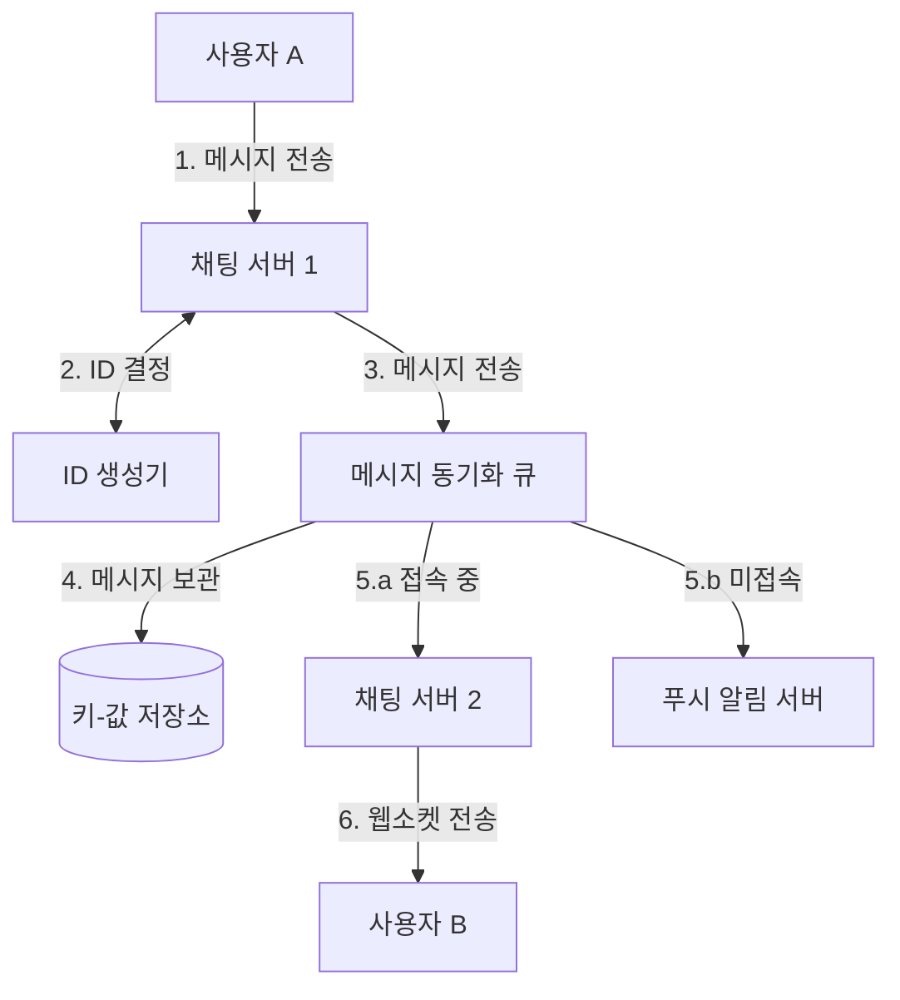

# 12장 : 채팅 시스템 설계
> **스터디 정보**  
> - **주차**: 6주차
> - **작성자**: 강상준  
> - **주제**: 12장 - 채팅 시스템 설계

---

11장에 이어서 real-time service중 하나이다. 채팅 서비스라면 아마 고민 안 해본 친구들이 없을 것 같은데 실시간 채팅 구현이 어렵다, 웹소켓을 사용해야 한다는데 뭔지 잘 모른다, SSE streaming.. 등 뭐가 많아서 망설였던 기억이 있다.
아마 노디에서는 풀링으로 실시간성 흉내정도 냈던 것 같다.

웹소켓은 대강 클라이언트와 서버간에 연결을 계속 열어두는 그런 프로토콜인 것으로 기억하는데 잘 모르겠다.

## 1단계 - 문제 이해 및 설계 범위 확정

항상! 내가 뭘 만들어야되는지 정도는 물어볼 수 있어야한다.
널리 알려진 개발자의 이미지는 그냥 말도 잘 못하고 0101밖에 모르는 이미지인데 하면 할수록 소통이 제일 중요하다는 걸 느낀다..

- 1:1 채팅? 1:N 채팅? 어떤 걸 설계해야 하는지
- 웹/앱?
- 트래픽 규모?
- 그룹 채팅 인원 상한
- 주요 기능은? 첨부파일 지원이나 사용자 스테이터스 표시 같은 기능이 있나?
- 메시지 길이 제한
- 종단 간 암호화를 지원해야 하는가?
    -> 이거 처음 듣는데 이렇게 설계하면 서버측에서도 대화 내용을 못 봐서 서버가 메시지 검색도 불가능하고 유해 콘텐츠/스팸 차단도 불가능하다. 다른 디바이스간의 대화 내용 동기화도 어려워진다.
- 채팅 이력은 어느정도 보관해야할까?

그냥 1단계에서 하는 거는 기능명세서 + 정책설계의 반복인 것 같음

## 2단계 - 개략적 설계안 제시 및 동의 구하기

채팅 서비스는 아래 기능을 제공해야 한다.
- 클라이언트들로부터 메시지 수신
- 메시지 수신자 결정 및 전달
- 수신자가 접속 상태가 아닌 경우에는 접속할 때까지 해당 메시지 보관
    -> 즉각 메시지를 쏴줄 수 없는 경우에 메시지가 유실되지 않게 푸시 알림만 쏴주고 서버 DB 혹은 메시지큐에 보관해둠. 온라인일 때 전송
    -> 근데 어차피 메시지는 서버측 DB에 계속 보관해두는 거 아닌가?
        -> 왓츠앱같은 서비스는 중계만해주고 전달되면 디비에서 대화내용을 지움.


```text
[철수가 카톡 전송]
      ⬇️
[카카오톡 채팅 서버] 
   👉 "어? 영희 웹소켓 끊겼네? 앱 완전히 껐구나!"
   👉 "그럼 실시간 웹소켓 대신 '10장에서 배운 푸시 알림(APNs/FCM)'으로 보내자!"
      ⬇️ (메시지 내용: "철수: 밥 먹었어?" 페이로드 전달)
[애플 APNs / 구글 FCM 서버]
      ⬇️ (OS 전용 초절전 통로로 폰에 전송)
[스마트폰 OS (iOS / Android)]
   👉 카톡 앱을 켜는 게 아니라, '폰 화면'에 알림 배너만 띄워줌!


이후 알림을 누르면 카카오톡 앱이 새로 켜지면서 ➡️ 카카오톡 서버와 웹소켓을 새로 연결하고 ➡️ '오프라인 동안 밀려있던 대화 내용들'을 서버에서 긁어와 화면을 채움.

```

메시지 전송 시나리오는 송신 클라이언트가 채팅 서비스에 HTTP 프로토콜로 연결한 다음 메시지를 보내 수신자에게 전달하라고 알린다. keep-alive 헤더를 사용하면 핸드셰이크 횟수를 줄일 수 있어 효과적이다.

근데 수신 시나리오에서는 서비스가 클라이언트에게 임의 시점에 연결을 만드는데 쉽게 쓰일 수 없기 때문에 다소 복잡해진다.
서버가 연결을 만드는 것처럼 동작할 수 있도록 제안된 기법들이
**폴링, 롱-폴링, 웹소켓 등의 기술이다**

### 폴링
클라이언트가 주기적으로 서버에게 메시지가 있냐고 물어보는 방식.

### 롱 폴링
클라이언트는 새 메시지가 반환되거나 타임아웃이 될 때까지 연결을 유지함. 새 메시지를 받으면 기존 연결을 종료하고 서버에 새로운 요청을 보내 모든 절차를 다시 시작.

약점: 
- 메시지를 보내는 클라이언트와 수신하는 클라이언트가 같은 채팅 서버에 접속하게 되지 않을 수 있다.
    -> 연결을 쥐고있지 않으니까 메시지를 전달할 방법이 없음.
- 서버 입장에서 클라이언트가 연결을 해제했는지 아닌지 알 좋은 방법이 없다.
- 메시지를 많이 받지 않는 클라이언트도 타임아웃이 일어날 때마다 서버에 주기적으로 다시 접속해야해서 여전히 비효율적이다

### 웹소켓
서버가 클라이언트에게 비동기 메시지를 보낼 때 가장 널리 사용하는 기술

웹소켓 연결은 클라이언트가 시작하고 한번 맺어진 연결은 양방향이고 항구적임.
처음에는 HTTP 연결이지만 특정 핸드셰이크 절차를 거쳐 웹소켓 연결로 업그레이드.
웹소켓 연결이 되면 서버가 클라이언트에게 비동기적으로 메시지 전송이 가능해짐.

연결이 항구적으로 유지되어야 하기 때문에 서버 측에서 연결 관리를 효율적으로 해야함.

-> 그냥 일단 양방향으로 송수신이 가능한 HTTP 연결을 열어놓는다고 생각하면 될듯.

### 개략적 설계안

#### 무상태 서비스
로그인, 회원가입, 사용자 프로필 표시 등을 처리하는 전통적인 요청/응답 서비스를 제공하는 서버
무상태 서비스는 로드밸런서 뒤에 위치한다 -> 무상태니까 로드밸런서 뒤에 붙여서 트래픽 분산시켜도 상관 없음.

**서비스 탐색 서비스?** 클라이언트가 접속할 채팅 서버의 DNS 호스트명을 클라이언트에게 알려주는 역할
-> 제3자 서비스 통해서 채팅방 링크 주는 느낌인가? 

#### 상태 유지 서비스

채팅 서비스는 상태 유지가 필요한 서비스이다. 각 클라이언트마다 채팅 서버와 독립적인 네트워크 연결을 유지해야 하기 때문이다.

> **Q. 송신 클라이언트와 수신 클라이언트가 서로 다른 채팅 서버에 연결되어도 상관없나?**  
> **A.** 전혀 상관없으며, 대규모 분산 환경에서는 서로 다른 서버에 연결되는 것이 자연스럽다.  
> 철수가 1번 서버에, 영희가 42번 서버에 연결되어 있어도 중간에 위치한 **메시지 브로커(Redis Pub/Sub, Kafka 등)**가 다리를 놓아주어 `1번 서버 ➡️ 메시지 브로커 ➡️ 42번 서버 ➡️ 영희 웹소켓` 순으로 안전하게 배달된다.

> **Q. 송수신자 서버가 달라도 된다면 그냥 연결될 때마다 위치를 갱신해서 그 서버로 쏴주면 되는 것 아닌가? 왜 굳이 '상태 유지(Stateful)'라고 부를까?**  
> **A.** 그 방식(접속 시마다 `"영희 ➡️ 42번 서버"`로 위치를 갱신하고 그쪽으로 라우팅하는 구조) 자체가 바로 **'상태 유지(Stateful) 시스템'의 핵심 동작 원리**다 
> 1. **물리적 소켓 유지**: 42번 서버는 영희에게 실시간으로 메시지를 밀어 넣어주기(Push) 위해 영희 폰과 연결된 TCP 소켓 파이프를 메모리에 계속 붙잡고(State 유지) 있어야 한다. (무상태처럼 연결을 버리면 실시간 수신 불가)  
> 2. **위치 장부(State) 추적**: 무상태(Stateless)와 달리, 시스템 어딘가(Redis/세션 저장소)에 *"영희는 현재 42번 서버에 연결되어 있음"*이라는 상태가 실시간으로 기록·추적되어야만 메시지를 목적지로 배달할 수 있다.


#### 제 3자 서비스 연동
푸시 알림을 위해 각 디바이스에 맞는 제3자 서비스를 사용할 필요가 있음

#### 규모 확장성

서버 한 대로 동시접속자 1M인 서비스를 감당할 수는 있는데 SPOF 문제도 있고 별로 바람직하지 않음. 항상 확장 가능성을 열어놔야함.

#### 저장소

**RDS OR NO SQL?** 채택을 고민할 때 따져야 할 것은 데이터의 유형과 읽기/쓰기 연산의 패턴이다. <- 읽기 연산 중심이면 NO SQL이 빠르지 않을까?..

채팅 시스템에서 데이터는 보통 다음 두 가지 유형으로 나뉜다.

- 사용자 프로필, 설정, 친구 목록처럼 일반적인 데이터
이런 데이터는 안정성을 보장하기 위해 RDS에 보관한다.
그렇게 읽기/쓰기가 많이 일어나는 데이터가 아니니까..

- 채팅 이력
    - 채팅 이력의 데이터 양은 엄청많다.
    - 최근의 주고받은 메시지가 주로 사용되고 오래된 메시지는 거의 사용되지 않는다.
    - 근데 또 검색 기능도 있어야되고 멘션된 메시지로 점프할 수도 있어야된다.
    - 1:1 채팅 앱의 경우 읽기:쓰기 비율은 대략 1:1 정도이다.

키-값 저장소가 추천된다.
    - 수평적 규모 확장이 쉽다.
    - 접근 지연시간이 낮다.
    - RDS는 데이터 가운데 롱 테일에 해당하는 부분을 잘 처리하지 못하는 경향이 있다. 인덱스가 커지면 데이터에 대한 무작위적 접근을 처리하는 비용이 늘어난다.
    - 많은 채팅 시스템이 채택하고있음

### 데이터 모델

1:1 채팅을 위한 테이블과 그룹 채팅을 위한 테이블은 특성을 생각해서 다르게 설계해야한다.

channel_id가 파티션키로 사용된다는 게 무슨 말일까?
-> 새로운 메시지가 들어왔을 때 어느 DB로 보내 저장할 건지 정해야되는데 이 기준이 파티션 키이다. 즉 같은 채널의 메시지는 같은 DB에 저장한다는 뜻.
-> 상식적으로 채팅방 조회할 때 메시지가 여러 서버에 분산되어있으면 조회할 때 골때린다.

#### 메시지 id
메시지 아이디는 다음의 속성을 만족해야하는데
- 고유해야한다.
- 정렬 가능해야하며 시간 순서와 일치해야한다.

스노플레이크 방식이나 지역적 순서 번호 생성기를 고려할 수 있다.
-> 지역적 순서 번호 생성기는 유일성을 같은 그룹 안에서만 보증하면 충분하다는 것
-> 메시지 사이의 순서는 같은 채널, 1:1채팅방 안에서만 유지되면 충분하기 때문에 구현하기 쉬운 접근법이다.

## 3단계 - 상세 설계

### 서비스 탐색
클라이언트에게 가장 적합한 채팅 서버를 추천하는 게 주요 역할
기준으로 **클라이언트의 위치, 서버의 용량 등**을 사용한다.

그냥 사용자가 채팅 접속 요청하면 최적의 서버 찾아서 웹소켓 열어주는 느낌인듯.

### 메시지 흐름

#### 1:1 채팅 메시지 흐름



1. **사용자 A가 채팅 서버 1로 메시지 전송**
2. **채팅 서버 1은 ID 생성기를 사용해 해당 메시지의 ID 결정**
3. **채팅 서버 1은 해당 메시지를 메시지 동기화 큐로 전송**
4. **메시지가 키-값 저장소에 보관됨**
5. **사용자 B의 접속 상태에 따른 분기**:
   - **(a) 사용자 B가 접속 중인 경우**: 메시지는 사용자 B가 접속 중인 채팅 서버(본 예제의 경우에는 채팅 서버 2)로 전송됨
   - **(b) 사용자 B가 접속 중이 아니라면**: 푸시 알림 메시지를 푸시 알림 서버로 보냄
6. **채팅 서버 2는 메시지를 사용자 B에게 전송** (사용자 B와 채팅 서버 2 사이에는 활성화된 웹소켓 연결이 있으므로 그것을 이용)

#### 여러 단말 사이의 메시지 동기화

각 단말은 cur_max_message_id라는 변수를 유지하는데, 해당 단말에서 관측된 가장 최신의 메시지 ID를 추적하는 용도이다.

- 수산자 ID가 현재 로그인한 사용자 ID와 같다. <- 나한테 온 메시지
- 키-값 저장소에 보관된 메시지로서, 그 ID가 cur_max_message_id보다 크다.
위 두 조건을 만족하는 메시지는 새 메시지로 간주한다.

cur_max_message_id는 단말마다 별도로 유지 관리하면 되는 값이라 키-값 저장소에서 새 메시지를 가져오는 동기화 작업도 쉽게 구현 가능

그니까 로컬에서 읽은 제일 최신 메시지 ID를 유지하고, 오프라인이다가 온라인으로 왔을 때 딱 거기부터 최신까지만 빨리 받아온다는 말인듯.

#### 소규모 그룹 채팅에서의 메시지 흐름

사용자 A가 메시지를 보내면 그 메시지가 다른 사용자들의 메시지 동기화 큐에 복사된다.
-> 한 그룹에 많은 사용자를 지원해야 하는 경우라면 바람직 하지 않다는데 왜?
    -> 단순 계산으로 초당 100개 메시지가 100,000명에게 전파되면 쓰기 연산이 초당 10,000,000건이다.
    -> 그래서 사용자 대상 메시지큐가 아니라 채팅방 대상으로 메시지 큐를 하나만 둔다.
    -> 유저 대상으로 메시지큐를 두느냐, 채팅방 대상으로 메시지 큐를 두느냐 이 차이이고 후자일 때는 유저한테 브로드캐스트할 방법이 추가로 필요
수신자는 여러 사용자가 보낸 메시지를 받을 수 있어야한다.


### 접속 상태 표시
접속상태 서버를 통해 사용자의 상태를 관리한다.
접속상태 서버도 클라이언트와 웹소켓으로 통신하는 실시간 서비스의 일부임.
상태가 바뀌는 시나리오는 다음과 같다.

#### 사용자 로그인
클라이언트와 실시간 서비스 사이에 웹소켓 연결이 맺어지고 나면, 접속상태 서버 A는 상태와 last_active_at 타임스탬프 값을 키-값 저장소에 보관. 이후 사용자가 접속 중인 것으로 표시

#### 로그아웃

사용자A-> 로그아웃 요청 -> API 서버 -> 접속 상태 서버 -> 키- 값 저장소 로 이어짐.
접속 상태 서버로 가서 사용자 status가 offline으로 바꾸고 상태 변경 이벤트를 실시간으로 브로드캐스트.

#### 접속 장애
사용자가 연결이 끊어지면 오프라인, 복구되면 온라인 상태로 변경하면 된다.
**근데 간헐적으로 끊어졌다 복구됐다 하는 상황이면?**
-> heartbeat event로 해결. 이거 운체인가 어디서 배웠는데 어딘지를 모르겠네
5초마다 보내고 30초 이상 안 오면 offline. 등으로 설정

#### 상태 정보의 전송
**사용자 A와 친구 관계에 있는 사용자들은 어떻게 해당 사용자의 상태 변화를 알게 될까?**

상태정보 서버는 발행-구독 모델을 사용한다.
-> 각각의 친구 관계마다 채널을 하나씩 둔다? A의 접속 상태가 변경되면 A-B, A-C, A-D ..에 쓴다. 각각 B, C , D가 A를 구독한다.
딱봐도 그룹 크기 커지면 감당 안 될 것 같은데? -> 진짜임

## 4단계 - 마무리
다음을 추가 논의해보자.

- 채팅이 미디어나 첨부파일을 지원하도록 하는 방법.
    - 압축 방식, 클라우드 저장소는 어떻게 쓸 건지, 미디어의 썸네일은 어떻게 띄울 건지..
- 종단 간 암호화
- 캐시 방식
- 로딩 속도 개선
- 오류 처리
    - 웹소켓이 수십만 사용자와 연결된 서버가 죽으면? 장애가 나는 건 100퍼센트니까 어떻게 복구할 건지를 생각해야함
    - 메시지 재전송은 어떻게?

