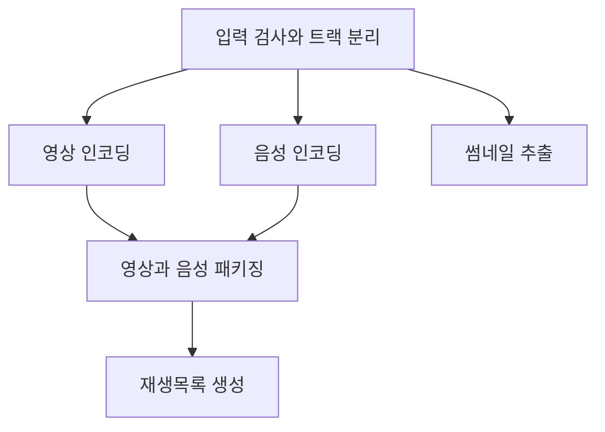

# 14장: 유튜브 설계

## 비디오 스트리밍 서비스란?

사용자가 영상을 올리면 서비스는 원본을 저장하고, 여러 기기와 네트워크 환경에서 볼 수 있도록 재생용 영상을 만든다. 시청자는 영상 전체를 다 받기 전에 재생을 시작하고, 재생하면서 뒤에 필요한 구간을 계속 내려받는다.

업로드와 재생은 병목이 생기는 곳이 다르다. 업로드에서는 큰 파일을 안정적으로 저장하고 인코딩을 끝내는 데 시간이 걸린다. 재생에서는 같은 영상이 여러 사람에게 반복 전송되므로 네트워크 대역폭과 전송 비용이 커진다.

## 1단계: 문제 이해 및 설계 범위 확정

### 요구사항

- 콘텐츠 제작자는 비디오를 올릴 수 있어야 한다.
- 시청자는 모바일 앱, 웹 브라우저, 스마트 TV에서 영상을 재생하고 화질을 선택할 수 있어야 한다.
- 여러 입력 포맷과 해상도를 지원하고, 업로드할 수 있는 파일 크기는 최대 1GB로 가정한다.
- 다국어 지원과 영상 보호를 고려한다.
- 빠른 업로드, 끊김이 적은 재생, 높은 가용성과 규모 확장성이 필요하다.
- 일간 활성 사용자는 500만 명, 하루 평균 이용 시간은 30분으로 가정한다.

댓글, 좋아요, 구독 등도 유튜브의 기능이지만, 이번 설계에서는 업로드와 시청 흐름에 집중한다.

### 개략적 규모 추정

책에서는 사용자 한 명이 하루 평균 영상 5개를 보고, 사용자 중 10%가 하루에 영상 한 개를 올리며, 영상의 평균 크기는 300MB라고 가정한다.

| 항목 | 계산 | 추정치 |
| --- | --- | --- |
| 하루 업로드 건수 | 500만 명 × 10% | 50만 건 |
| 하루 신규 원본 저장량 | 50만 건 × 300MB | 약 150TB |
| 하루 재생 건수 | 500만 명 × 5회 | 2,500만 건 |
| 하루 재생 전송량 | 2,500만 건 × 0.3GB | 약 7.5PB |
| 하루 CDN 전송 요금 | 750만 GB × $0.02 | 약 $150,000 |

150TB는 하루에 추가되는 원본 기준이다. 여러 화질의 변환본, 썸네일, 복제본까지 보관하면 필요한 공간은 더 커진다.

## 2단계: 개략적 설계안 제시 및 동의 구하기

### 주요 구성 요소

| 구성 요소 | 역할 |
| --- | --- |
| 로드밸런서와 API 서버 | 업로드 권한 확인, 업로드 URL 발급, 영상 정보와 상태 조회 |
| 메타데이터 DB와 캐시 | 영상 ID, 제목, 소유자, 공개 범위, 처리 상태, 재생 위치 관리 |
| 원본 저장소 | 업로드한 비디오 파일을 객체 단위로 보관 |
| 트랜스코딩 서버 | 원본을 여러 해상도·비트레이트의 재생용 영상으로 변환 |
| 변환본 저장소 | 생성한 영상, 음성, 재생목록 등을 보관 |
| 완료 큐와 완료 핸들러 | 변환 완료 이벤트를 받아 DB의 상태와 캐시를 갱신 |
| CDN | 시청자에게 네트워크상 가까운 엣지에서 영상 데이터를 전달 |

영상 본문은 객체 저장소에 두고, DB에는 그 파일을 가리키는 경로와 조회에 필요한 정보를 저장한다. API 서버는 로그인, 권한, 영상 상태 등을 처리하고, 파일 업로드나 재생에 쓰이는 대용량 바이트는 저장소와 CDN 경로로 보낸다.

### 비디오 업로드 흐름

1. 클라이언트가 업로드를 요청하면 API 서버가 사용자 권한을 확인하고 영상 ID와 원본 저장 위치를 정한다.
2. 클라이언트가 파일을 원본 저장소에 올린다. 제목, 설명과 같은 메타데이터는 API 서버로 보내며 파일 전송과 병행할 수 있다.
3. 원본 업로드가 끝나면 트랜스코딩 작업이 시작된다.
4. 작업 서버가 변환본을 저장소에 기록하고 완료 이벤트를 보낸다. 완료 핸들러는 이를 받아 DB와 캐시를 갱신한다.
5. 서비스가 공개할 화질의 세그먼트와 재생목록이 준비되면 재생 가능 상태로 바꾼다.

사용자 화면에서는 `업로드 중`, `변환 중`, `재생 가능`, `실패`를 구분할 수 있다. 파일 전송이 끝났을 때 바로 재생 가능으로 표시하면 플레이어가 아직 만들어지지 않은 재생목록을 요청할 수 있다.

### 비디오 스트리밍 흐름

1. 시청자가 재생을 요청하면 서비스가 영상 정보와 접근 권한을 확인하고 재생목록 위치를 알려준다.
2. 플레이어가 CDN에서 재생목록을 읽고, 현재 기기와 네트워크 환경에 맞는 영상 버전을 선택한다.
3. 플레이어는 처음에 필요한 몇 개의 세그먼트를 받아 재생을 시작하고, 재생하는 동안 뒤 구간을 받아 버퍼를 채운다.
4. 네트워크가 느려지면 다음 구간을 낮은 비트레이트로 요청하고, 충분히 빨라지면 더 높은 화질로 올릴 수 있다.

네트워크 상황에 따라 재생할 버전을 바꾸는 것을 적응형 비트레이트 스트리밍(ABR)이라고 한다. HLS와 MPEG-DASH는 여러 버전과 구간을 플레이어에게 전달하는 데 쓰인다. CDN의 캐시에 요청한 세그먼트가 없으면 원본 서버 역할을 하는 변환본 저장소에서 가져올 수 있다.

## 3단계: 상세 설계

### 트랜스코딩이 필요한 이유

같은 영상이라도 스마트 TV와 모바일 브라우저가 지원하는 코덱이 다를 수 있고, 같은 휴대폰에서도 와이파이와 이동통신의 대역폭은 달라진다. 그래서 업로드한 파일을 그대로 제공하기보다 360p, 720p, 1080p처럼 여러 재생 버전을 만들어둔다.

비트레이트는 영상 1초를 표현하는 데 쓰는 비트 수다. 같은 길이에서 비트레이트가 높으면 전송할 데이터가 많다. 비슷한 인코딩 조건에서는 높은 비트레이트가 화질 유지에 유리하지만, 해상도나 비트레이트 숫자만으로 화질이 결정되지는 않는다. 코덱과 장면의 복잡도도 영향을 준다.

| 구분 | 예시 | 역할 |
| --- | --- | --- |
| 코덱 | H.264, HEVC, VP9 | 영상 프레임을 압축하고 재생할 때 복원하는 규칙 |
| 컨테이너 | MP4, WebM | 압축된 영상·음성 트랙과 메타데이터를 묶는 파일 형식 |
| 스트리밍 방식 | HLS, MPEG-DASH | 재생목록과 미디어 구간을 통해 영상을 전달하는 방식 |

예를 들어 `720p.mp4`의 `MP4`는 컨테이너다. 그 안에는 H.264로 압축한 영상과 AAC로 압축한 음성을 담을 수 있다. 같은 `.mp4`라도 내부 코덱에 따라 기기가 재생할 수 있는지가 달라진다.

### 코덱은 어떻게 영상 용량을 줄일까?

어떻게 용량을 줄이는지가 궁금해서 간단하게 찾아봤다.

고정된 카메라 앞에서 사람이 오른쪽으로 걸어가는 영상을 생각해볼 수 있다. 앞뒤 프레임을 비교하면 배경은 거의 그대로이고, 사람의 위치만 조금 이동한다. 코덱은 이처럼 비슷한 화면이 반복되는 성질을 이용한다.

1. **예측**. 현재 화면을 블록으로 나눈다. 같은 프레임의 주변 블록으로 내용을 예측하거나, 다른 프레임에서 비슷한 블록을 찾아 얼마나 움직였는지 기록한다.
2. **잔차 계산**. 실제 화면에서 예측한 화면을 뺀 차이를 구한다. 예측이 잘 맞으면 표현할 차이가 작아진다.
3. **변환과 양자화**. 차이를 계수로 변환하고, 계수를 일정 단위로 반올림해 데이터량을 줄인다. 양자화를 강하게 적용할수록 파일 크기는 줄지만 복원한 화면의 세부 정보도 줄어든다.
4. **부호화와 복원**. 움직임 정보와 남은 계수를 효율적으로 기록한다. 재생할 때 디코더는 같은 예측을 만든 뒤 기록된 차이를 더해 화면을 복원한다.

움직임이 많은 스포츠 영상과 배경이 고정된 강의 영상은 같은 1080p라도 필요한 데이터량이 다를 수 있다. 전송량과 화질을 같이 관리하려면 해상도별로 비트레이트를 정하고, 필요한 경우 영상 특성도 고려한다.

### GOP와 영상 분할

GOP(Group of Pictures)는 여러 프레임을 묶은 단위다. 기준 프레임과 다른 프레임을 참조해 압축한 프레임이 함께 들어갈 수 있다.

프레임끼리 참조 관계가 있기 때문에 임의의 위치에서 영상을 잘라 작업 서버에 보내면 첫 프레임부터 복원하기 어려울 수 있다. 변환을 병렬로 처리하려면 필요한 참조 데이터가 구간 안에 있도록 독립적으로 디코딩할 수 있는 경계에 맞춰 분할해야 한다. 책에서는 단말이 GOP 경계에 맞춰 분할할 수 없다면 서버의 전처리기가 대신 처리하는 방법도 설명한다.

GOP는 코덱에서 프레임을 묶는 단위이고, 스트리밍 세그먼트는 플레이어가 HTTP로 가져오는 구간이다. 인코딩 작업 단위와 전송 단위를 설계할 때는 각각의 경계를 맞추는 이유가 있다. 예를 들어 720p에서 360p로 전환하려면, 두 화질에서 같은 재생 시점의 구간을 자연스럽게 이어받을 수 있어야 한다.

### DAG로 트랜스코딩 작업 나누기

DAG(Directed Acyclic Graph)는 방향이 있고 순환이 없는 그래프다. 노드는 작업을, 화살표는 뒤 작업을 실행하려면 앞 작업의 결과가 필요하다는 뜻을 나타낸다.

트랙을 분리한 뒤에는 영상 인코딩, 음성 인코딩, 썸네일 추출을 서로 기다리지 않고 실행할 수 있다. 패키징은 필요한 영상과 음성이 모두 준비된 뒤에 시작한다. 제작자가 워터마크를 요청하면 해당 영상을 인코딩하기 전에 워터마크를 적용하는 작업도 넣을 수 있다.

3-1 알고리즘에서 배운 **위상 정렬**이 여기서 다시 나온다. 앞서 끝나야 할 작업이 모두 완료된 노드만 실행 대상으로 삼으면 의존성을 어기지 않으면서 병렬 처리할 수 있다. 예를 들어 트랙 분리 후 영상 인코딩이 40초, 음성 인코딩이 10초, 썸네일 생성이 5초라면, 세 작업을 직렬로 수행할 때는 55초가 걸린다. 워커가 충분하고 세 작업을 동시에 시작할 수 있다면 모두 끝나기까지 약 40초가 걸린다. 이후 패키징 시간과 큐 대기는 별도로 더해진다.

### 트랜스코딩 아키텍처

| 구성 요소 | 역할 |
| --- | --- |
| 전처리기 | 원본 검사와 구간 분할, 설정에 따른 DAG 생성, 중간 입력 저장 |
| DAG 스케줄러 | 작업 간 의존성을 확인하고 실행 가능한 작업을 큐에 등록 |
| 자원 관리자 | 대기 작업의 우선순위와 워커의 가용 상태를 보고 작업을 배정 |
| 작업 서버 | 인코딩, 썸네일 추출, 워터마크, 병합 등 실제 연산 수행 |
| 임시 저장소 | 구간 파일과 중간 결과를 보관해 뒤 작업과 재시도에서 재사용 |

책의 자원 관리자는 실행할 작업이 쌓이는 작업 큐, 사용 가능한 워커를 관리하는 큐, 현재 실행 중인 작업을 추적하는 실행 큐를 둔다. 스케줄러가 어떤 작업을 지금 실행할 수 있는지 판단하면, 자원 관리자는 그 일을 어느 워커에 맡길지 결정한다. 예를 들어 GPU를 쓸 수 있는 인코딩 작업과 썸네일 추출 작업을 서로 다른 워커에 할당할 수 있다.

### 메시지 큐에서 비동기성과 병렬성이 중요한 이유

메시지 큐가 있으면 업로드를 처리하는 서버는 인코딩이 끝날 때까지 연결을 붙들고 있을 필요가 없다. 업로드를 접수한 뒤 작업을 큐에 넣고 상태를 반환하고, 뒤에서 워커가 별도 속도로 작업을 처리한다.

큐에는 대용량 영상 자체 대신 `video_id`, 입력 객체 경로, 구간 번호, 출력 화질처럼 작업에 필요한 정보를 넣을 수 있다. 예를 들어 첫 번째 구간의 입력이 준비되면 인코더가 바로 그 구간을 처리하고, 동시에 다른 워커는 두 번째 구간을 다운로드할 수 있다. 한 영상 안의 구간뿐 아니라 여러 영상의 작업도 워커 여러 대에 나누어 실행할 수 있다.

DAG가 어떤 작업을 동시에 실행할 수 있는지 정하고, 큐는 실행할 일을 워커에게 전달한다. 큐에 일이 쌓여도 워커 처리량이 계속 부족하면 재생 준비 시간은 길어진다. 그래서 큐 길이뿐 아니라 가장 오래 기다린 작업의 대기 시간과 작업 종류별 처리 속도도 같이 본다.

### 업로드 속도와 재시도

큰 파일을 여러 파트로 보내면 연결이 한번 끊겼을 때 실패한 파트부터 다시 올릴 수 있다. 가능한 범위에서 파트를 병렬로 전송하면 대역폭을 더 잘 활용할 수 있다. 다만 사용자의 업로드 회선 자체가 병목이면 동시 요청을 늘려도 속도 개선에는 한계가 있다.

저장소의 멀티파트 업로드는 파일을 바이트 단위로 나눠 전송하고 서버에서 다시 합치는 방식으로 쓸 수 있다. 각 파트를 곧바로 독립적인 인코딩 입력으로 쓰려면 GOP처럼 영상의 참조 관계를 고려한 경계가 추가로 필요하다.

책에서는 미국 사용자에게 북미 업로드 센터를, 아시아 사용자에게 아시아 업로드 센터를 지정하는 방안도 제시한다. 재생용 CDN 엣지와 업로드 요청을 받는 위치를 각각 고려하면 시청자와 제작자의 네트워크 지연을 줄일 수 있다.

### 미리 서명된 URL로 S3에 직접 업로드하기

미리 서명된 URL(presigned URL)은 클라이언트가 S3의 특정 객체에 정해진 요청을 일정 시간 동안 보낼 수 있도록 서버가 미리 서명한 URL이다.

1. 클라이언트가 API 서버에 `POST /upload`로 업로드를 요청한다.
2. API 서버는 로그인한 사용자의 권한을 확인하고 `uploads/사용자ID/영상ID/original.mp4`처럼 해당 업로드의 객체 키를 정한다.
3. API 서버가 그 키에 대한 `PUT` 요청을 일정 시간 동안 허용하는 URL을 발급한다.
4. 클라이언트는 영상 파일을 그 URL로 보내 S3에 직접 저장한다.
5. 서버가 해당 객체가 올라왔는지 확인한 뒤 검증을 거쳐 인코딩 작업을 등록한다.

이 구조에서는 API 서버가 영상 파일 전체를 받아 다시 S3로 보내는 부담이 줄어든다. 클라이언트는 AWS 자격 증명 없이도 발급받은 작업을 수행할 수 있다.

유효한 URL을 가진 쪽이 사용할 수 있으므로 객체 키를 업로드마다 다르게 만들고 유효기간을 제한한다. 같은 URL로 만료 전에 여러 번 요청할 수 있고, 같은 키에 다시 쓰면 기존 객체가 교체될 수 있다. 따라서 영상 처리의 기준이 되는 원본이 바뀌지 않게 하려면 업로드 상태와 객체 버전 또는 체크섬을 확인하는 방식도 고려할 수 있다.

### 영상 보호

- **DRM**은 재생 라이선스를 통해 어떤 환경에서 콘텐츠를 볼 수 있는지 제어한다. 책에서는 FairPlay, Widevine, PlayReady를 예로 든다.
- **콘텐츠 암호화**는 영상을 암호화하고, 재생 권한이 있는 단말에 복호화에 필요한 키를 제공하는 방식이다.
- **워터마크**는 영상이나 이미지에 소유자 식별 정보를 넣는다. 표시나 추적에 활용할 수 있다.

미리 서명된 업로드 URL은 원본을 누가 어디에 올릴 수 있는지를 다룬다. DRM과 영상 암호화는 업로드된 영상을 누가 재생할 수 있는지에 관련된 설계다.

### CDN 비용과 시청 패턴

영상 시청량은 고르게 분포하지 않는다. 일부 인기 영상은 반복해서 요청되고, 많은 영상은 드물게 재생된다. 책에서 말하는 롱테일 분포를 고려하면 모든 영상과 화질을 모든 지역에 미리 배치하는 데 드는 비용이 커질 수 있다.

| 전략 | 기대 효과 | 고려할 비용 |
| --- | --- | --- |
| 인기 영상을 엣지에 미리 배치 | 같은 바이트를 원본에서 반복해 가져오는 횟수를 줄이고 첫 재생을 빠르게 한다. | 예상이 빗나가면 전송한 파일이 디스크만 차지한다. |
| 비인기 영상은 요청 시 원본에서 가져오기 | 거의 보지 않는 콘텐츠를 모든 지역에 미리 복제하는 비용을 줄인다. | 첫 조회에서 원본을 읽는 지연과 부하가 생긴다. |
| 지역별로 다른 영상과 화질 배치 | 실제로 보는 지역과 화질에 저장 공간을 사용할 수 있다. | 지역·시간대·화질별 시청량을 수집하고 배치 정책을 관리해야 한다. |
| 저수요 영상의 일부 화질을 나중에 변환 | 보지 않을 화질까지 만드는 인코딩·저장 비용을 줄인다. | 첫 요청 시 해당 화질을 바로 제공하기 어려울 수 있다. |

캐시 적중률이 높아지면 엣지가 원본에서 가져오는 바이트가 줄어든다. 시청자에게 전달하는 바이트에 별도로 과금하는 계약이라면 캐시 적중률이 올라가도 그 전송 요금은 그대로 발생할 수 있다. 따라서 비용을 비교할 때는 **엣지에서 시청자로 보낸 바이트**, **원본에서 엣지로 가져간 바이트**, **엣지를 미리 채우는 데 쓴 바이트**를 구분해서 본다.

시청 패턴을 분석해 CDN을 운영하는 것 자체에도 비용이 든다. 영상별 조회 수뿐 아니라 지역별 전송량, 시청자가 어느 구간까지 보는지, 어떤 화질이 자주 선택되는지에 따라 유리한 배치가 달라진다. 분석과 배치를 복잡하게 할수록 로그 처리, 예측, 장비 운영에도 자원이 더 필요하다. 최근 일정 기간의 지역별 시청량으로 인기 영상을 정하는 정책을 먼저 적용하고, 원본 전송량과 재생 품질이 얼마나 개선되는지 비교할 수 있다.

### ISP는 컴네에서 배운 3사 통신사를 뜻할까?

같은 개념이다. ISP(Internet Service Provider)는 사용자나 기업에 인터넷 연결을 제공하는 사업자다. 국내에서는 KT, SKT, LG U+처럼 인터넷 회선을 제공하는 곳을 예로 들 수 있다.

CDN을 ISP 망 내부나 가까운 곳에 배치하면, 사용자에게 자주 제공하는 영상을 멀리 있는 원본까지 요청할 필요가 줄어든다. Netflix Open Connect는 일부 ISP 망에 캐시 장비를 두는 실제 사례다. 예를 들어 같은 지역에서 여러 사람이 같은 영상을 보면 ISP 망 가까이에 있는 장비에서 영상 데이터를 반복해서 제공할 수 있다. 이 방식의 이점은 충분한 트래픽이 있는지, 장비를 둘 공간과 회선을 마련할 수 있는지에도 영향을 받는다.

### 오류 처리

| 상황 | 대응 |
| --- | --- |
| 업로드 도중 연결 끊김 | 업로드 세션을 기준으로 성공한 파트는 유지하고 실패한 파트만 재시도 |
| 워커 종료 또는 일시적인 변환 실패 | 완료되지 않은 구간이나 출력 화질만 다른 워커에서 재시도 |
| 원본 손상 또는 지원하지 않는 포맷 | 변환을 중단하고 사용자에게 실패 원인을 표시 |
| 완료 이벤트 중복 | 영상 ID·구간·화질 등으로 작업을 식별하고, 이미 반영한 완료 상태는 다시 적용해도 결과가 같도록 처리 |
| API 서버·캐시·DB 장애 | API 요청을 정상 인스턴스로 분산하고, 캐시 복제본과 DB 장애 조치로 조회·저장 경로 복구 |

9장 크롤러와 10장 알림 시스템에서도 큐에서 꺼낸 작업 도중 서버가 종료될 수 있었다. 영상 변환은 재실행 비용까지 크므로, 완료된 구간과 화질을 기록하고 남은 작업만 다시 실행할 수 있어야 한다.